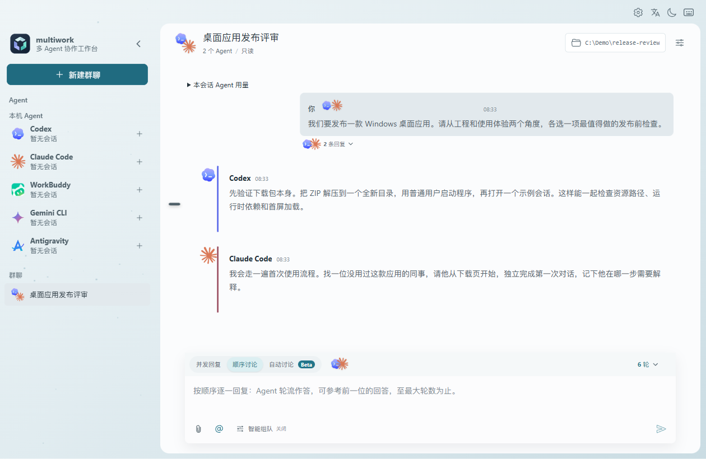

<div align="center">

<picture>
  <source media="(prefers-color-scheme: dark)" srcset="frontend/public/logos/multiwork-wordmark-dark.svg">
  
</picture>

### One local workspace for your AI agents

Give Codex, Claude Code and API-connected models the same task. Follow each reply, inspect usage and stop individual agents as they work.

[](https://github.com/xuilen/multiwork/releases/download/v1.1.0/multiwork-1.1.0-windows-x64.zip) [](desktop/package.json) [](LICENSE)

**[Explore the website](https://xuilen.github.io/multiwork/)** · **[Download for Windows](https://github.com/xuilen/multiwork/releases/download/v1.1.0/multiwork-1.1.0-windows-x64.zip)** · [Release notes](https://github.com/xuilen/multiwork/releases/tag/v1.1.0) · [简体中文](README.zh-CN.md)

</div>

## Inside the workspace



The Windows desktop app above shows a sample group conversation. Each participant has its own reply, so you can compare suggestions and choose who takes the next step.

## Ways to work

| Goal | How it works |
| --- | --- |
| Compare independent answers | Give several agents the same prompt in concurrent mode. Read replies as they arrive and stop an individual participant if needed. |
| Develop an idea together | Use ordered turns or automatic discussion so participants can build on earlier replies and review each other's work. |
| Check usage | Inspect per-agent runs and available token counts. Supported Codex sessions also expose reported quota windows. The fields available vary by provider. |
| Resume a task | The home task board groups work by status. Select a card to jump back to its original conversation. |

## Quick start

1. Download the Windows x64 ZIP, extract the entire archive into one folder and open `multiwork.exe`. The package includes the Electron runtime. [Download v1.1.0](https://github.com/xuilen/multiwork/releases/download/v1.1.0/multiwork-1.1.0-windows-x64.zip)
2. For a native CLI, finish its own sign-in and verify a reply in your terminal, then refresh discovery in the app's agent settings. For multiple model APIs, configure separate Chat Completions-compatible endpoints, model names and credentials. [Agent catalog](CATALOG.md)
3. Start a conversation, choose participants and send a prompt such as “List three checks for a Windows desktop release.” Select a working folder and enable write access when a task calls for file changes.

Conversation history and task state stay on your machine. Selected agents contact the model services configured for them. The release includes a SHA-256 checksum for the ZIP. [Checksums and release notes](https://github.com/xuilen/multiwork/releases/tag/v1.1.0)

## Run from source

Use Node.js 22.12 or newer and npm. From the repository root, run the following commands.

```sh
npm --prefix frontend ci
npm --prefix desktop ci
npm --prefix desktop run dev
```

[Desktop setup](desktop/README.md) · [Architecture](architecture.md) · [Contributing](CONTRIBUTING.md)

## Credits and license

xuilen independently maintains this distribution of multiwork. Its public history starts with the Windows distribution snapshot. The application builds on [Meldwork](https://github.com/Ryder-Sun/Meldwork) and is distributed under the Apache License 2.0. The distribution includes the original copyright and third-party notices. [License](LICENSE) · [Notices](NOTICE) · [Commercial use](COMMERCIAL_USE.md)
