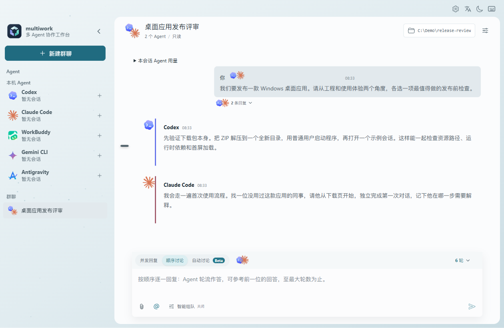

<div align="center">

<picture>
  <source media="(prefers-color-scheme: dark)" srcset="frontend/public/logos/multiwork-wordmark-dark.svg">
  
</picture>

### 把常用的 AI Agent 放进同一个本地工作台

让 Codex、Claude Code 和通过 API 接入的模型讨论同一个问题，随时查看每位成员的回复、进度与用量。

[](https://github.com/xuilen/multiwork/releases/download/v1.1.0/multiwork-1.1.0-windows-x64.zip) [](desktop/package.json) [](LICENSE)

**[访问产品官网](https://xuilen.github.io/multiwork/)** · **[下载 Windows 版](https://github.com/xuilen/multiwork/releases/download/v1.1.0/multiwork-1.1.0-windows-x64.zip)** · [版本说明](https://github.com/xuilen/multiwork/releases/tag/v1.1.0) · [English](README.md)

</div>

## 工作台实览



上图是 Windows 桌面版的示例会话。选择成员后，可以对照各自的回复，再决定下一步交给谁。

## 选择协作方式

| 想做什么 | 在 multiwork 里怎么做 |
| --- | --- |
| 比较多个模型的判断 | 在群聊中使用并发回复。成员完成后就能看到结果，等待期间可以单独停止某个 Agent。 |
| 围绕一个方案继续讨论 | 让成员按顺序发言，或使用自动讨论，让参与者基于已有回复补充、质疑和复核。 |
| 控制上下文与用量 | 按 Agent 查看运行记录和可用的 token 统计。支持的 Codex 会话还会显示其报告的额度窗口，其他服务的可见字段取决于接口。 |
| 找回上次做到哪里 | 首页任务看板按待处理、进行中、已完成整理任务，点击卡片回到原对话。 |

## 快速开始

1. 下载 Windows x64 ZIP，完整解压到一个文件夹，双击其中的 `multiwork.exe`。预编译版本包含 Electron 运行环境。[下载 v1.1.0](https://github.com/xuilen/multiwork/releases/download/v1.1.0/multiwork-1.1.0-windows-x64.zip)
2. 使用原生 CLI 时，先在终端完成对应工具的登录，确认它能独立回复，再到工作台的 Agent 管理界面刷新检测。多模型 API 可分别配置兼容 Chat Completions 的地址、模型名和凭据。[Agent 目录](CATALOG.zh-CN.md)
3. 新建会话，选好成员后发出任务。首次使用可以试试「为 Windows 桌面应用列出三个发布前检查项」。需要 Agent 修改文件时，再为该会话选择工作目录并开启写入权限。

聊天记录与任务状态保存在本机。已选 Agent 会按自己的配置向模型服务发送请求。ZIP 的 SHA-256 校验文件位于同一发布页。[校验文件与版本说明](https://github.com/xuilen/multiwork/releases/tag/v1.1.0)

## 从源码运行

源码版首页的 **Agent Token 用量** 面板可按今天、近 7 天或全部时间汇总已保存会话的输入和输出。「已上报回复 / 总回复」中，只要上报过一项 Token 数就计入分子；横线表示未上报。如果所选时段有额度数据，还会显示最近一次上报的剩余额度和对应的回复时间，方便判断记录有多旧。这是历史快照，不是账户实时余额。

需要 Node.js 22.12 或更高版本及 npm。在仓库根目录执行以下命令。

```sh
npm --prefix frontend ci
npm --prefix desktop ci
npm --prefix desktop run dev
```

[桌面端配置](desktop/README.md) · [架构](architecture.md) · [贡献指南](CONTRIBUTING.md)

## 来源与许可

此发行项目由 xuilen 独立维护，公开提交历史从 Windows 发行快照开始。应用基于 [Meldwork](https://github.com/Ryder-Sun/Meldwork) 开发，沿用 Apache License 2.0。原作者和第三方标识的归属记录在随包分发的声明中。[许可证](LICENSE) · [版权声明](NOTICE) · [商业使用](COMMERCIAL_USE.md)
